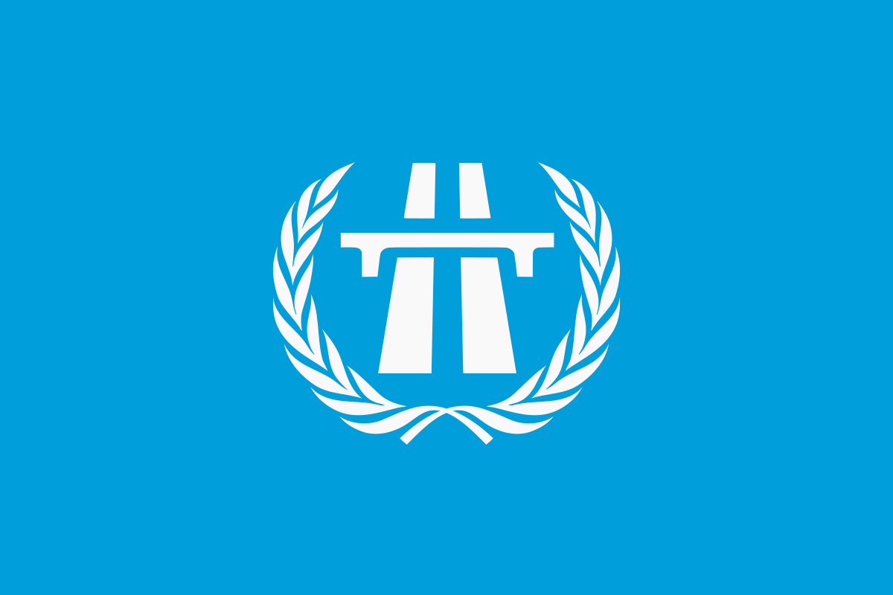

# Panomatix — international cross-reference database of road signs

Panomatix maps every road sign of the **Vienna Convention on Road Signs and Signals** to its national
equivalents, its rendering variants, its 2006 numbering and its OpenStreetMap tags. It is built from the
two official texts of the Convention and from a per-country catalogue of national sign codes, so that
every fact can be traced back to a source, and it is now edited collaboratively through the website.

```
VIENNA:C-14.1  Maximum speed limit
  ├─ 2006:     VIENNA:C,14
  ├─ designs:  circle / white / red border / black symbol   → fr:B14, de:274, be:C43, es:R-301 …
  │            circle / yellow / red border / black symbol  → fi:C32, se:C31
  └─ OSM:      traffic_sign=maxspeed · maxspeed=*
```

## Contents

| File | What it is |
|---|---|
| `full_database.json` | **The deliverable.** One entry per sign — 248 Vienna signs (`VIENNA:*`), 17,763 national signs with no Vienna equivalent (`OTHER:*`), 3 Vienna 2006 signs dropped in 2023 (`VIENNA2006:*`) — covering 101 countries and regions. |
| `road_sign_images/` | National sign images, one folder per country: `<iso>_<country>/<vienna category>/<vienna or other>/` (e.g. `fr_france_monaco/c_prohibitory_and_restrictive_signs/vienna/FR-B14.svg`). `vienna` = sign matched to a Vienna Convention entry, `other` = national sign of that category; `sd_unclassified/` holds national signs with no category. Files are named `<ISO>-<national code>`, which is how the website finds the picture of `fr:B14`. Each country has an `images_links.json` (source URLs). |
| `vienna_convention_images/` | Official illustrations of the Vienna Convention signs (2026 amendment), named after the design they show — see [Official images](#official-images). |
| `Conv_road_signs_2006v_EN.pdf`, `ECE-TRANS-WP1-2023-2-Rev2e.pdf` | Sources: the 2006 consolidated Convention and the 2023 revision (ECE/TRANS/WP.1/2023/2/Rev.2). |
| `fetch_wikipedia_captions.py` | Collects the English captions of the sign pictures on the Wikipedia "Road signs in …" pages, used to link national signs to Vienna signs by meaning (see [How it is built](#how-it-is-built)). |
| `website/` | Collaborative editor and REST API (browsing, country comparison, accounts, history, image uploads) — see [`website/README.md`](website/README.md). |

## Browsing the database

The way to browse and edit the database is the website in `website/` (Node.js ≥ 24.7, two dependencies: Nodemailer and sharp):

```sh
cd website
npm install             # Nodemailer (account emails) and sharp (image compression)
npm run import          # load ../full_database.json into SQLite
npm run dev             # http://127.0.0.1:8080
```

Each sign page shows the official Vienna models, every design with the countries that use it, their codes,
texts, parameters, additional panels and OSM tags, with the national pictures from `road_sign_images/`.
"Compare countries" lays the signs out as a sign × country table. Edits made on the site are written back with `npm run export`; review the diff, then commit.

## Official images

`vienna_convention_images/` holds the official illustrations of the Convention (2026 amendment), downloaded
from the [Commons gallery](https://commons.wikimedia.org/wiki/User:%E6%B4%97%E5%92%A7%E5%93%88%E5%9B%89/Gallery/Vienna_Convention_on_Road_Signs_and_Signals_2026_Amendment)
(public domain, United Nations). Each file is named after the design it shows, with the labels of
`full_database.json`:

```
<category>/<number>_<shape>_<background_color>_<border_color>_<symbol_color>[_<band>_<band_color>][_<prohibition_bar>[_<bar_continuity>]][_<n>].svg

a_danger_warning_signs/A-01.1_triangle_white_red_black.svg
a_danger_warning_signs/A-01.1_diamond_yellow_dark-blue_dark-blue.svg
c_prohibitory_and_restrictive_signs/C-03.1_circle_white_red_black_with-bar_interrupted.svg
c_prohibitory_and_restrictive_signs/C-17.1_circle_white_black_light-grey_parallel-lines_black.svg
a_danger_warning_signs/A-02.1_triangle_white_red_black_2.svg      ← other symbol of the same design
```

Spaces and underscores inside a value are written `-`, a null value `none`; `_2`, `_3`… are other symbols
or layouts allowed for the same design (Commons numbered them `-1`, `-2`…). The website ties each image to
the design(s) of the sign that carry exactly the same labels and shows it on that design.
`images_links.json` lists, for each file, its labels, its original Commons name, URL, licence and author.

The labels were read from the images themselves (shape and colours measured on a rendering, then checked
by eye for bars and bands). 482 of the 506 images match a design of `full_database.json`. The 24 others
are named after what they show and flagged on the site as "no matching design":

- **probable errors in the database** — `C-01.2` and `C-16.1` have a red ground in the JSON, white with a
  red border on the official image; `D-01.2` and `D-01.6` have a black ground in the JSON, blue on the image;
- **variants the database does not list** — green direction signs (`G-01.2`, `G-02.1`, `G-04.2`, `G-09.1`,
  `G-10.2`, `G-12.1`, `G-25.1`), yellow temporary signs (`G-02.2`, `G-02.3`, `G-05.2`, `G-05.4`, `G-12.3`,
  `G-26.1`–`G-26.3`, `G-27.1`, `G-28.1`), and `F-11.1` with a red symbol;
- **signs added by the 2026 amendment** and absent from the 2023 text: `D-03.2`, `G-26.4`.

Conversely, the gallery has no image for `A-25.1`–`A-25.4`.

## Data model

An entry is identified by its **2023 Vienna number** (`VIENNA:A-23.1`). National-only signs use `OTHER:*`;
2006 signs without a 2023 successor use `VIENNA2006:*`.

```jsonc
{
  "reference": "VIENNA:A-23.1",
  "legacyReferences": ["VIENNA:A,25"],          // generic 2006 symbol number (union of the designs)
  "name": { "en": "…", "fr": "…", "de": "…" },
  "description": { "en": "…" },                  // 2023 text
  "symbolMayBeReversed": true,
  "officialSign": {
    "designs": [                                 // one entry per distinct rendering, no duplicates
      {
        "shape": "triangle", "background_color": "white", "border_color": "red", "symbol_color": "black",
        "band": "none", "prohibition_bar": null, "model": "one",
        "versions": ["2006", "2023"],            // which text(s) allow this rendering
        "legacyReferences": ["VIENNA:Aa,25"],    // model-specific 2006 number: Aa on triangles, Ab on diamonds
        "jurisdictions": {                       // the countries that use THIS design
          "germany": {
            "countryCode": "de",
            "languages": { "de": { "code": "de:151", "codes": ["de:151"], "text": "…", "description": null } },
            "parameters": { … },                 // numeric values found in the national declinations
            "additional": { "bottom": [ { "index": 1, "reference": ["de:1004-30"] } ] },
            "osm": { "traffic_sign": ["DE:151"] }
          }
        }
      }
    ],
    "additional": { "bottom": [ { "index": 1, "reference": ["VIENNA:H-01.1"] } ] }
  },
  "osm": { "traffic_sign_generic": "hazard", "implied_tags": { "railway": "level_crossing" } },
  "relatedSigns": [ … ]                          // other catalogue entries attached to this sign
}
```

A sign appears **once**; what varies between countries is which *design* they use, so national codes
hang off the design, not off the sign. Design labels are closed vocabularies (`shape`, `background_color`,
`border_color`, `symbol_color`, `band`, `band_color`, `prohibition_bar`, `bar_continuity`, `model`); the
list of values is in [`website/sign.schema.json`](website/sign.schema.json) (`$defs`). Two labels deserve a word:

- **`band`** — the cancellation band of "end of …" signs: `single_band` (one oblique band, e.g. France)
  or `parallel_lines` (several parallel lines, e.g. Germany). Both texts allow both; the 2023 text
  states the parallel lines are *preferable*, and for `D-06.2` the 2006 text allowed the single bar only.
- **`prohibition_bar`** — the red oblique bar of "no entry for …" signs, which Contracting Parties may
  omit. It slopes the opposite way to a cancellation band.

Additional panels use a stacking **`index`** (1 = directly under the sign, 2 below it, …) and a list of
admissible `reference`s per slot, both at Convention level and per country. The slot is always present,
possibly empty, so that panels can be added.

## How it is built

`full_database.json` was generated by a pipeline that is no longer in this repository (the `scripts/`
folder, its intermediate `comparison_2006-2023.json` and `template.json` were removed): it parsed Annex 1
of the 2023 PDF, mapped every 2006 sign to its 2023 successor, expressed each rendering as uniform labels,
then attached the national codes of a per-country catalogue (`road_signs_all.json`) to the designs. The
2006 ↔ 2023 correspondence was established sign by sign from the two texts — no official concordance
table exists. The 2023 text covers the car symbol and the percentage in a single sign
(`A-02.1` descent, `A-03.1` ascent: "a car or a percentage or both"). The database keeps them apart, as the
2006 text did (`A,2c`/`A,2d`, `A,3c`/`A,3d`): `A-02.1` / `A-03.1` hold the percentage designs and
`A-02.2` / `A-03.2` the vehicle-symbol designs (car or lorry, with or without a percentage). `A-02.2` is the
number the 2023 text itself uses once, under `G-19.1`; `A-03.2` is not in the 2023 text. Danger warning signs
of model two list two designs (black rim and symbol, or dark blue rim and symbol). `fetch_wikipedia_captions.py` is the one piece kept: it fetched the Wikipedia captions used
to link national signs to Vienna signs by meaning; it reads `traffic_sign_links_by_country.json`, which is
not in the repository either.

Since then the file is maintained through the website (`npm run import` → edits → `npm run export`), which
validates every entry against `website/sign.schema.json`.

**What is derived and what is asserted.** Numbers, names, descriptions, models, colours, band and bar
rules come from the Convention texts. National codes come from the per-country catalogue and the
Wikipedia pages. Three things are *heuristics*:

1. the attachment of a country to a design (yellow ground for SE, FI, PL; single band for FR, ES, PT;
   red bar kept for FR, BE, ES, PT; …);
2. the OSM `traffic_sign` values, built as `<ISO prefix>:<national code>`; the format is verified
   against the OSM convention only for some countries;
3. the French and German names, translated for this database; they are not official translations.

`wikidata` (`QXXXXXXX`) and `toBeAdded` are placeholders.

## Name, licence, versioning

A reviewer made the point that three things should be settled at the earliest stage of a project like
this — a name, a licence and a versioning strategy. Here is where the project stands on each.

### Name

The project is called **Panomatix**. It is short, unique, pronounceable in the languages of the countries
covered, and it promises nothing that could become false — not "Europe", not "Vienna", not "2023".
Identifiers inside the data are deliberately *not* branded: a sign is `VIENNA:C-14.1`, a national code
is `de:274`, an OSM value is `DE:274`. Anyone can quote a Panomatix identifier without quoting Panomatix,
which is what a cross-reference database is for.

### Licence

The repository is dedicated to the public domain under **CC0 1.0 Universal**, see the `LICENSE` file.
This applies to everything in the repository that the project itself can license — data
(`full_database.json`), scripts and the website alike — with no
attribution requirement and no share-alike obligation, for any purpose including commercial use and
import into OpenStreetMap, Panoramax, or any other project.

**Sources** are the exception: the Convention texts and their official illustrations are United Nations
documents, and the national pictures in `road_sign_images/` keep whatever licence they were obtained under
(source URLs in each `images_links.json`). None of them is relicensed here.

### Versioning

Two version numbers describe the data (they were kept in `full_database.meta.json`, which is not in the
repository at the moment):

- **`schemaVersion`** (semantic versioning, currently `1.0.0`) describes the *shape* of the JSON.
  - *Patch*: documentation and legend changes only.
  - *Minor*: additive changes — a new optional field, a new label value, a new country. A consumer
    written for 1.x keeps working on any later 1.y; within a major, fields are never renamed or removed
    and label vocabularies only grow.
  - *Major*: anything else. Removing `designId`, moving `jurisdictions` under `designs` and adding the
    panel `index` were exactly this kind of change; they were made before 1.0 so that 1.0 does not carry
    them as debt.
- **`dataVersion`** (ISO date, currently `2026-09-17`) describes the *content*. It changes whenever a
  sign, a code or a mapping is added or corrected, with no compatibility promise beyond the schema.

Two conventions follow. The top-level container is a flat array; moving
the version numbers inline, in a wrapper object, would be a 2.0 change and is the first candidate for
it. And identifiers are stable: a `VIENNA:*` reference is never reassigned to a different sign; if the
Convention renumbers again, the current numbers move to `legacyReferences` exactly as the 2006 numbers did.
